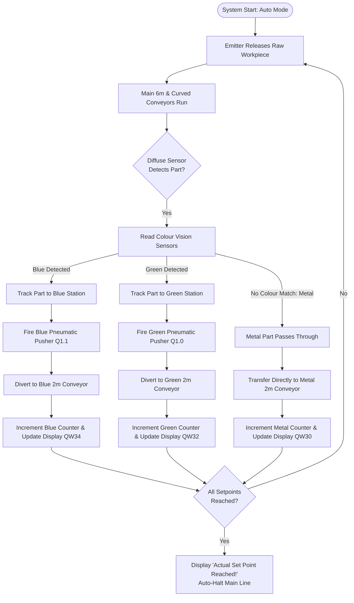
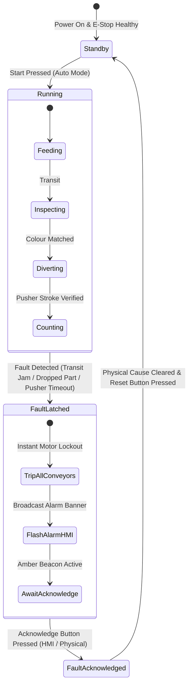

# 🏭 Automated Industrial Colour Counting & Sorting Machine

[](https://new.siemens.com/)
[]()
[]()
[](https://factoryio.com/)
[]()
[-blue.svg)]()
[](LICENSE)

> Developed by **Nik Mohamad Azizi Bin Nik Yahya** for **TIA Portal Programming Level 1 (TIA-PRO1)**, Bachelor of Technology (B.Tech) in Industrial Electronic Automation, Faculty of Electronic Engineering Technology, Universiti Malaysia Perlis (UniMAP).

---

## 📌 Project Overview

This project implements a fully automated industrial **Colour Counting and Sorting System** controlled by a **Siemens SIMATIC S7-1500 PLC (CPU 1516-3 PN/DP)** and visualized through a **Siemens KTP700 Basic PN Human-Machine Interface (HMI)**. The entire manufacturing sequence is simulated in a high-fidelity 3D digital twin environment using **Factory I/O**, linked via **Siemens PLCSIM**.

The system automates the multi-criteria identification, routing, and batch accounting of raw material workpieces (Metal, Green Plastic, and Blue Plastic). Workpieces travel across a high-speed conveyor network, are identified by synchronized diffuse and optical vision sensors, and are diverted into designated sort chutes by pneumatic pushers with closed-loop reed switch feedback.

<div align="center">
  
  <p><em>Figure 1: Full 3D Digital Twin Simulation Cell in Factory I/O featuring conveyor network, vision sensors, pneumatic pushers, and operator console</em></p>
</div>

### System Interface Highlights

| Factory I/O Operator Console | Live WinCC HMI Runtime | Automated Sorting Action |
|:---:|:---:|:---:|
| <br/><b>Physical Control Cabinet & Digital LED Counters</b> | <br/><b>KTP700 Basic HMI Live Animated Dashboard</b> | <br/><b>Pneumatic Pusher Diverting Green Workpiece</b> |

---

## ⚙️ System Architecture & Hardware Topology

The automation network is structured over industrial **PROFINET (PN/IE)**, providing deterministic cyclic communication between the controller, operator interface, and virtual field I/O:

- **Programmable Logic Controller (PLC):** Siemens SIMATIC S7-1500 (CPU 1516-3 PN/DP) — IP: `192.168.0.67`
- **Operator Interface (HMI):** Siemens SIMATIC KTP700 Basic PN (7-inch Touch Panel) — IP: `192.168.0.2`
- **Virtual Field I/O Interface:** Factory I/O Siemens S7-1200/1500 PLCSIM Virtual Ethernet Adapter
- **Conveyor Layout:**
  - One (1) 6-metre main belt conveyor (`K_Belt_6m` / `Q0.3`)
  - One (1) curved belt conveyor (`K_Curved_Belt_CW` / `Q0.7`)
  - Three (3) 2-metre sorting branch conveyors (`Metal: Q0.4`, `Green: Q0.5`, `Blue: Q0.6`)
- **Inspection & Sensing System:**
  - Two (2) Colour Vision Sensors (`B_Vision_1_Blue: I51.4`, `B_Vision_2_Green: I51.3`)
  - Three (3) Diffuse Photoelectric Part Sensors (`Blue: I50.6`, `Green: I50.5`, `Metal: I50.4`)
- **Actuators & Pneumatics:**
  - Two (2) Double-acting Pneumatic Pushers (`Green: Q1.0`, `Blue: Q1.1`) with magnetic limit reed switches (`Back: I50.7 / I51.1`, `Front: I51.0 / I51.2`)
  - One (1) Automated Workpiece Emitter (`K_Emitter: Q1.2`)
  - Three (3) Chute Exit Workpiece Removers (`Metal: Q2.0`, `Green: Q2.1`, `Blue: Q2.2`)

<div align="center">
  
  <p><em>Figure 2: Siemens TIA Portal Devices & Networks topology — CPU 1516-3 PN/DP and KTP700 Basic PN on Subnet PN/IE_1</em></p>
</div>

---

## 🔄 Automated Process Sequence & Sorting Logic

<div align="center">

<details>
<summary align="center"><b>🔄 Click to expand Automated Process Flowchart</b></summary>

<br/>



</details>

</div>

### Operational Modes
1. **Auto Mode (`FC_Mode` / `FC_Conveyor`):**
   - Full automated workpiece generation, transit tracking, colour discrimination, pneumatic diversion, and piece accounting.
   - Continuous multi-sensor background monitoring for jams, starvation, or dropped parts.
2. **Jog Mode (Manual Maintenance):**
   - Dedicated Jog Left (`S_jogLeft: I51.5`) and Jog Right (`S_jogRight: I51.6`) push buttons for conveyor alignment and physical maintenance clearing.
   - Software and hardware direction interlocks prevent concurrent forward and reverse contactor energization.
3. **Target Setpoint Batch Mode:**
   - Operators set production targets via HMI numeric entry fields (`setpoint_Metal`, `setpoint_Green`, `setpoint_Blue`).
   - When all current quantities equal or exceed configured setpoints (`M_actSetP: M11.0`), the system triggers a clean auto-stop sequence and illuminates the completion banner.

---

## 📋 Comprehensive I/O Tag Assignment Table

### Digital Inputs (DI)

| Tag Name | Logical Address | Data Type | Physical Component / Field Function |
|---|:---:|:---:|---|
| `S_Start` | `%I50.0` | Bool | Start Push Button (Normally Open) |
| `S_Stop` | `%I50.1` | Bool | Stop Push Button (Normally Closed) |
| `S_Reset` | `%I50.2` | Bool | Counter & System Reset Push Button |
| `S_EStop` | `%I50.3` | Bool | Emergency Stop Mushroom Push Button (NC) |
| `B_Diffuse_3_Metal` | `%I50.4` | Bool | Diffuse Photoelectric Sensor — Metal Chute Station |
| `B_Diffuse_2_Green` | `%I50.5` | Bool | Diffuse Photoelectric Sensor — Green Sorting Station |
| `B_Diffuse_1_Blue` | `%I50.6` | Bool | Diffuse Photoelectric Sensor — Blue Sorting Station |
| `S_Pusher_2_Back_Green` | `%I50.7` | Bool | Green Pusher Retracted Limit Sensor (Reed Switch) |
| `S_Pusher_2_Front_Green` | `%I51.0` | Bool | Green Pusher Extended Limit Sensor (Reed Switch) |
| `S_Pusher_1_Back_Blue` | `%I51.1` | Bool | Blue Pusher Retracted Limit Sensor (Reed Switch) |
| `S_Pusher_1_Front_Blue` | `%I51.2` | Bool | Blue Pusher Extended Limit Sensor (Reed Switch) |
| `B_Vision_2_Green` | `%I51.3` | Bool | Vision Sensor — Green Colour Discriminating Output |
| `B_Vision_1_Blue` | `%I51.4` | Bool | Vision Sensor — Blue Colour Discriminating Output |
| `S_jogLeft` | `%I51.5` | Bool | Jog Left Manual Conveyor Button |
| `S_jogRight` | `%I51.6` | Bool | Jog Right Manual Conveyor Button |
| `S_acknowledge` | `%I51.7` | Bool | Fault Alarm Acknowledge Push Button |

### Digital & Analog Outputs (DQ / AQ)

| Tag Name | Logical Address | Data Type | Field Actuator / Indicator Function |
|---|:---:|:---:|---|
| `P_Start_Light` | `%Q0.0` | Bool | Green Illuminated Start Indicator Lamp |
| `P_Stop_Light` | `%Q0.1` | Bool | Red Illuminated Stop Indicator Lamp |
| `P_Reset_Light` | `%Q0.2` | Bool | White Illuminated Reset Indicator Lamp |
| `K_Belt_6m` | `%Q0.3` | Bool | Main 6m Belt Conveyor Motor Contactor (Forward) |
| `K_Belt_2m_3_Metal` | `%Q0.4` | Bool | Metal Sort Chute Conveyor Motor Contactor |
| `K_Belt_2m_2_Green` | `%Q0.5` | Bool | Green Sort Chute Conveyor Motor Contactor |
| `K_Belt_2m_1_Blue` | `%Q0.6` | Bool | Blue Sort Chute Conveyor Motor Contactor |
| `K_Curved_Belt_CW` | `%Q0.7` | Bool | 90° Curved Belt Conveyor Motor Contactor (CW) |
| `K_Pusher_2_Green` | `%Q1.0` | Bool | Green Sorting Pneumatic Cylinder Solenoid Valve |
| `K_Pusher_1_Blue` | `%Q1.1` | Bool | Blue Sorting Pneumatic Cylinder Solenoid Valve |
| `K_Emitter` | `%Q1.2` | Bool | Automated Raw Workpiece Feeder Emitter Actuator |
| `K_Belt_6m_rev` | `%Q1.3` | Bool | Main 6m Belt Conveyor Motor (Reverse — Jog Mode) |
| `K_Remover_3_Metal` | `%Q2.0` | Bool | Metal Chute Finished Workpiece Remover Actuator |
| `K_Remover_2_Green` | `%Q2.1` | Bool | Green Chute Finished Workpiece Remover Actuator |
| `K_Remover_1_Blue` | `%Q2.2` | Bool | Blue Chute Finished Workpiece Remover Actuator |
| `P_Display_3_Metal` | `%QW30` | Int | Physical 7-Segment Digital Display — Metal Count |
| `P_Display_2_Green` | `%QW32` | Int | Physical 7-Segment Digital Display — Green Count |
| `P_Display_1_Blue` | `%QW34` | Int | Physical 7-Segment Digital Display — Blue Count |
| `P_jogLeft_Light` | `%Q2.3` | Bool | Jog Left Blue Indicator Lamp |
| `P_jogRight_Light` | `%Q2.4` | Bool | Jog Right Blue Indicator Lamp |
| `P_acknowledge_Light` | `%Q2.5` | Bool | Fault Acknowledge Indicator Lamp |

---

## 🧱 Modular PLC Program Hierarchy

The TIA Portal project is structured using modular industrial programming standards, dividing core functionality across dedicated **Organization Blocks (OB)**, **Function Blocks (FB)**, **Functions (FC)**, and **Global Data Blocks (DB)**:

<div align="center">
  
  <p><em>Figure 3: Siemens TIA Portal Project Tree — Program Blocks, DB Instances, Tag Tables, and HMI Hierarchy</em></p>
</div>

| Block | Type | Number | Technical Function |
|---|:---:|:---:|---|
| **Main** | OB | `OB1` | Cyclic executive block; orchestrates synchronous execution of all operational FCs and FBs. |
| **FC_Sort** | FC | `FC1` | Coordinates workpiece sorting execution and activates pneumatic actuators based on sensor evaluation. |
| **FC_Conveyor** | FC | `FC2` | Handles motor interlock logic, auto run state, and forward/reverse jog commands for all five belts. |
| **FC_Mode** | FC | `FC3` | Manages operational state latching (Auto / Jog / Stop / E-Stop) and button illumination. |
| **FC_Count** | FC | `FC4` | Coordinates batch counting instances, synchronizing HMI tags and physical digital LED displays. |
| **FC_Emitter** | FC | `FC5` | Controls workpiece feed pacing; releases parts only after downstream clearance is confirmed (`M_Request_Part`). |
| **FC_FaultTransit** | FC | `FC6` | Calculates travel time windows; flags lost workpieces or conveyor transit jamming. |
| **FC_Sensors** | FC | `FC7` | Generates deterministic positive-edge (`P_TRIG`) one-shot pulses from raw sensor transitions. |
| **FC_Fault** | FC | `FC8` | Master alarm collector; latches faults, trips emergency stops, and manages two-stage acknowledgment. |
| **FB_Sorting** | FB | `FB1` | Instance-based tracking function block; monitors individual workpiece transit time to synchronize pusher stroke. |
| **FB_Counting** | FB | `FB2` | Instance-based piece counter (`CTU`); records verified sorts per colour with independent reset handling. |
| **FB_FaultPusher** | FB | `FB3` | Closed-loop pneumatic actuator diagnostic block; monitors extend and retract limit timeout states. |
| **DB_HMI** | DB | `DB1` | Global exchange Data Block interfacing HMI setpoints, command bits, and status telemetry. |
| **DB_Fault** | DB | `DB20` | Centralized fault word holding discrete latch bits for all four industrial alarm categories. |

---

## 🛡️ Industrial Fault Detection & Safety Management

A key technical highlight of this automation architecture is its **multi-layered closed-loop fault monitoring matrix**. Rather than assuming hardware operations succeed, the program actively verifies physical behavior against deterministic software timers:

<div align="center">

<details>
<summary align="center"><b>🚨 Click to expand Safety & Fault Latched State Diagram</b></summary>

<br/>



</details>

</div>

### Monitored Industrial Fault Categories

| Fault ID | Condition | Diagnostic Mechanism | System Safety Action |
|---|---|---|---|
| **FAULT: MAIN CONVEYOR** | Workpiece jammed or fallen off the main 6m belt | Part release recorded by `FC_Emitter` fails to arrive at the diffuse detection window within calibrated timeout (`FC_FaultTransit`). | Immediate conveyor stoppage, flashing red/amber beacon, HMI alarm banner displayed. |
| **FAULT: SORT CHUTE** | Workpiece jammed in sorting chute or diverted incorrectly | Pusher activation recorded, but workpiece fails to trigger the chute arrival sensor within expected window. | Feeder lockout, conveyor stoppage, chute maintenance alert displayed on HMI. |
| **FAULT: PUSHER 1 (BLUE)** | Blue pneumatic pusher cylinder stuck or jamming | Cylinder solenoid energized, but front reed limit switch (`I51.2`) fails to confirm full stroke before timeout (`FB_FaultPusher`). | Actuator de-energized, system emergency stop tripped, prevents damage to pusher tooling. |
| **FAULT: PUSHER 2 (GREEN)** | Green pneumatic pusher cylinder stuck or jamming | Cylinder solenoid energized, but green front reed switch (`I51.0`) fails to close within timeout window. | Actuator de-energized, system emergency stop tripped, operator inspection required. |

<div align="center">
  
  &nbsp;
  
  <p><em>Figure 4: Left: HMI detecting Main Conveyor Jam / Part Lost with active Acknowledge prompt. Right: Dual simultaneous Pusher and Chute fault display</em></p>
</div>

---

## 🖥️ Siemens KTP700 Basic HMI Design

The human-machine interface is engineered for ergonomic single-screen supervisory control using **WinCC Basic**:

<div align="center">
  
  <p><em>Figure 5: Siemens KTP700 Basic Root Screen layout designed in TIA Portal WinCC Basic</em></p>
</div>

- **Dynamic Plant Schematic:** Animated graphic representation of the 6m conveyor, curved transfer belt, and 3 sorting chutes with live pusher stroke and sensor activation indicators.
- **Recipe & Setpoint Controls:** Direct touch-entry numeric input fields (`SetPoint Quantity`) allowing production managers to configure batch requirements per colour.
- **Real-Time Piece Telemetry:** Live counter display fields (`Current Quantity`) dynamically synchronized with physical hardware counters.
- **Two-Stage Alarm Response:** High-visibility flashing alarm text banners with an amber `ACKNOWLEDGE` button requiring deliberate operator intervention prior to clearing system faults.
- **Batch Complete Signaling:** High-contrast `Actual Set Point Reached!` notification that automatically suspends feeder cycles once batch quotas are fulfilled.

<div align="center">
  
  <p><em>Figure 6: Automated batch completion notification displayed on the HMI when all three colour setpoints are satisfied</em></p>
</div>

---

## 📁 Repository Structure

```
PLC_AutomatedModularProduction-WithSiemensAndFesto/
├── assets/                                 # High-resolution architectural figures & HMI captures
│   ├── factoryio_cell_overview.png         # Full 3D Factory I/O digital twin cell layout
│   ├── factoryio_control_panel.png         # Physical control cabinet & digital LED displays
│   ├── factoryio_green_pusher_sort.png     # Workpiece pneumatic diversion in 3D simulation
│   ├── factoryio_metal_passthrough.png     # Metal raw material passthrough operation
│   ├── factoryio_fault_lost_part.png       # Workpiece dropped / lost part simulation
│   ├── factoryio_fault_pusher_jam.png      # Pusher obstruction fault verification
│   ├── factoryio_config.png                # Factory I/O I/O driver configuration
│   ├── factoryio_drivers.png               # Tag address binding to Siemens driver
│   ├── plc_cpu1516_properties.png          # SIMATIC S7-1516-3 PN/DP hardware properties
│   ├── plc_network_architecture.png        # PROFINET subnet topology (PLC + HMI)
│   ├── tia_project_tree.png                # Full TIA Portal project organization tree
│   ├── hmi_root_design.png                 # KTP700 Basic Root Screen design layout
│   ├── hmi_running_active.png              # Live WinCC HMI runtime operational state
│   ├── hmi_setpoint_reached.png            # Batch quota auto-stop notification
│   ├── hmi_fault_main_conveyor.png         # Conveyor jam / lost part alarm banner
│   ├── hmi_fault_multiple.png              # Dual simultaneous fault display verification
│   └── ladder/                             # High-res captures of all 19 ladder logic networks
│       ├── ladder_ob1_overview.png
│       ├── ladder_main_ob1_full.png
│       ├── ladder_fc_conveyor_p1.png
│       ├── ladder_fc_conveyor_p2.png
│       ├── ladder_fc_count.png
│       ├── ladder_fc_emitter.png
│       ├── ladder_fc_fault_p1.png
│       ├── ladder_fc_fault_p2.png
│       ├── ladder_fc_fault_transit.png
│       ├── ladder_fc_mode_full.png
│       ├── ladder_fc_sensors.png
│       ├── ladder_fc_sort.png
│       ├── ladder_fb_counting_full.png
│       ├── ladder_fb_fault_pusher.png
│       └── ladder_fb_sorting_full.png
├── docs/                                   # Academic & technical documentation
│   └── 241503239 - Project Report (tia-pro1).pdf   # Complete 43-page formal engineering report
├── factoryio/                              # Factory I/O 3D digital twin simulation scene
│   └── 241503239_TIAPRO1.factoryio         # Full virtual sorting plant scene with configured sensors & actuators
├── plc/                                    # Siemens TIA Portal project archives
│   ├── 241503239_TIAPRO1.zap21             # Compressed TIA Portal project archive
│   └── 241503239_TIAPRO1.ap21              # Primary project definition file
├── .gitattributes                          # Git normalization & binary attributes
├── .gitignore                              # Siemens TIA temporary file exclusion rules
├── LICENSE                                 # GNU General Public License v3.0
└── README.md                               # Comprehensive system documentation
```

---

## 🚀 How to Open & Simulate

### 1. Clone the Repository

```bash
git clone https://github.com/aziziyahya/PLC_AutomatedModularProduction-WithSiemensAndFesto.git
cd PLC_AutomatedModularProduction-WithSiemensAndFesto
```

### Prerequisites
- **Siemens TIA Portal v16** (or higher, e.g., TIA Portal v21) with **STEP 7 Professional** & **WinCC Basic**
- **Siemens S7-PLCSIM**
- **Factory I/O v2.5** (with Siemens S7-1200/1500 driver license)

### Step-by-Step Simulation Procedure
1. **Retrieve the Project Archive:**
   - Launch TIA Portal, select `Project` → `Retrieve...`, and choose `plc/241503239_TIAPRO1.zap21` (or open `plc/241503239_TIAPRO1.ap21`).
2. **Start S7-PLCSIM Virtual Controller:**
   - In the TIA Portal project tree, select `PLC_NIK [CPU 1516-3 PN/DP]`.
   - Click **Start Simulation** (`Ctrl + Shift + X`). S7-PLCSIM will initialize and assign IP `192.168.0.67`.
   - Compile and download the hardware configuration and software blocks to PLCSIM. Switch the virtual CPU to `RUN`.
3. **Launch WinCC HMI Runtime:**
   - Select `HMI_1 [KTP700 Basic PN]` in the project tree.
   - Click **Start Simulation** to open the virtual touch panel runtime on your desktop.
4. **Connect Factory I/O 3D Simulation:**
   - Open `factoryio/241503239_TIAPRO1.factoryio` directly in Factory I/O (or place it in your `Documents/Factory IO/My Scenes` directory and open it from the Scenes browser).
   - Go to `File` → `Drivers`. Select **Siemens S7-PLCSIM**.
   - Under `Configuration`, select **S7-1500** as the model.
   - Click **Connect**. A green checkmark will appear next to the driver status indicating cyclic communication.
5. **Run the Cell:**
   - Enter desired piece targets on the HMI `SetPoint Quantity` fields.
   - Press the physical or HMI `START` push button to initiate automated colour counting and sorting.

---

## 📜 License & Acknowledgments

This project is open-source under the **[GNU General Public License v3.0](LICENSE)**.

- Academic curriculum: **TIA Portal Programming Level 1 (TIA-PRO1)** certification, Faculty of Electronic Engineering Technology, Universiti Malaysia Perlis (UniMAP).
- Simulation software: **Factory I/O** developed by Real Games.
- Industrial automation software: **Totally Integrated Automation (TIA) Portal** by Siemens AG.
